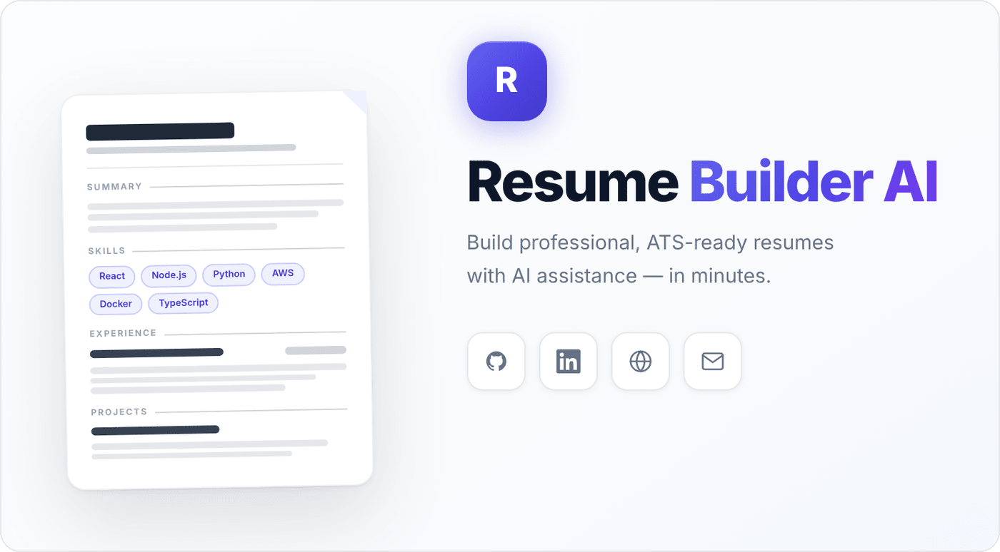
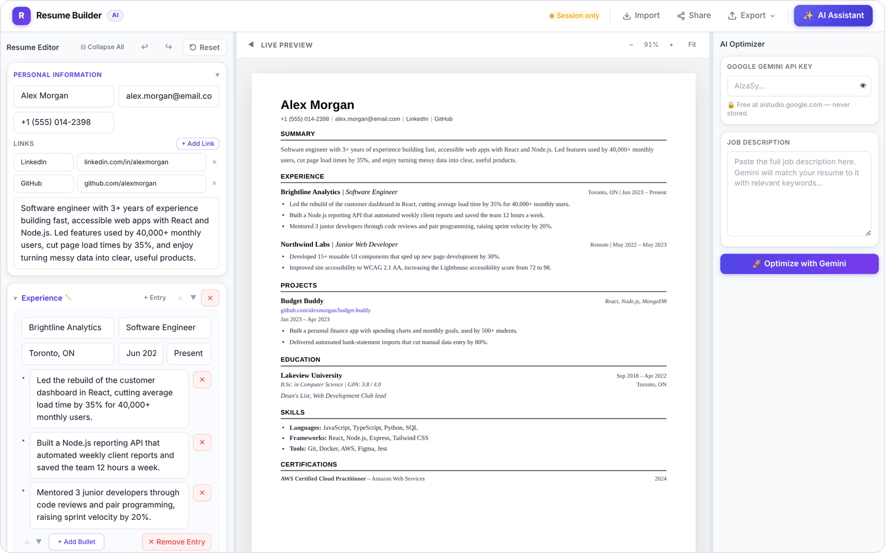
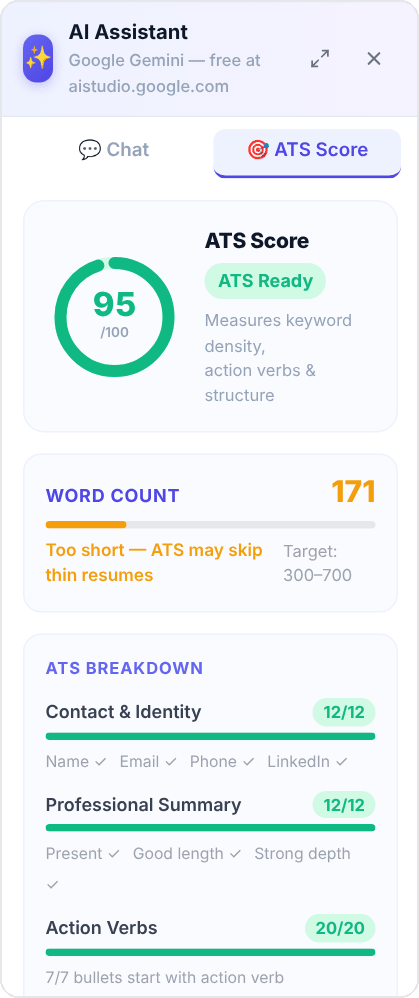
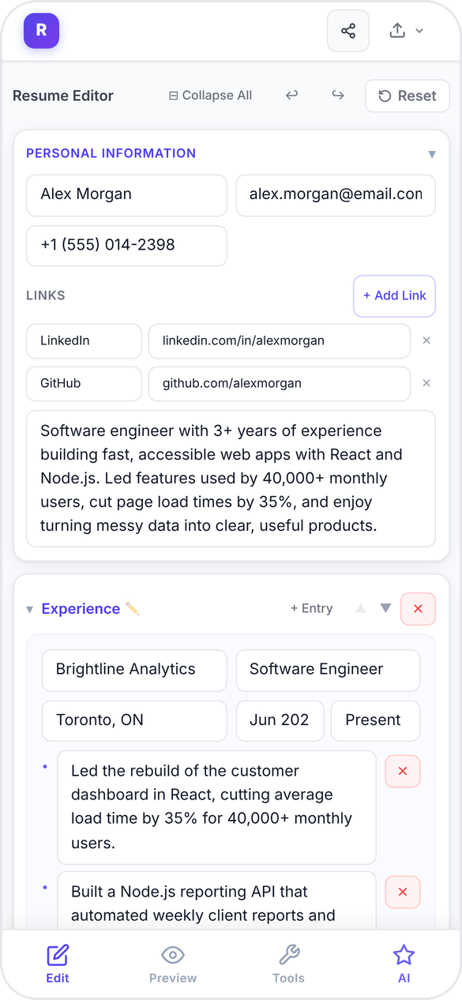
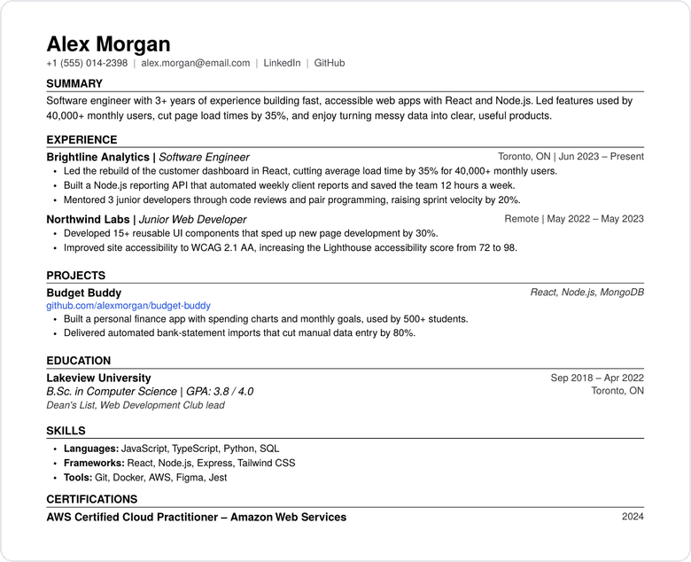
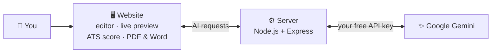

<p align="center">
  
</p>

<p align="center">
  
  
  
  
  
  
</p>

<!-- Live demo: once the site is deployed, add its link here, for example:
<p align="center"><a href="https://your-site.netlify.app"><b>🚀 Try it live</b></a></p>
-->

**Resume Builder AI** helps you write a resume that looks professional and gets past the screening software many companies use, called an Applicant Tracking System (ATS). Fill in your details and watch the page update as you type. AI can polish your wording or tailor the resume to a job, and then you download it as a PDF or Word file. It's free, there's no sign-up, and your resume is never stored on a server.

<p align="center">
  
</p>

## ✨ Features

- ✏️ **Simple editor**: sections for experience, education, projects, skills and certifications, plus your own custom sections. You can add, remove and reorder anything, and use bold, italic and underline where you need them.
- 👀 **Live preview**: the finished page updates as you type, with zoom controls.
- 🎯 **ATS score**: a score out of 100 that checks your contact details, summary, action verbs, measurable results, skills keywords, sections and bullet points. It updates instantly in your browser, lists your weakest areas first, and each one has a one-click AI fix.
- 🤖 **AI assistant**: ask in plain words, like *"make my summary stronger"* or *"add numbers to my experience"*, and the change is made to your resume directly.
- 💼 **Tailor to a job**: paste a job description, and the AI Optimizer rewrites your resume with matching keywords and stronger bullet points.
- 📂 **Import your old resume**: upload a PDF, and AI fills in the editor for you.
- 📄 **Download as PDF or Word**: a clean, single-column layout that ATS software can read.
- 🔗 **Share a link**: send your resume through WhatsApp, LinkedIn or Facebook.
- ↩️ **Undo and redo**: up to 30 steps with <kbd>Ctrl</kbd>+<kbd>Z</kbd> and <kbd>Ctrl</kbd>+<kbd>Y</kbd>.
- 📱 **Works on phones**: Edit, Preview, Tools and AI buttons sit at the bottom of the screen.

<table>
  <tr>
    <th>🎯 ATS score &amp; AI assistant</th>
    <th>📱 On your phone</th>
    <th>📄 The downloaded PDF</th>
  </tr>
  <tr>
    <td valign="top"></td>
    <td valign="top"></td>
    <td valign="top"></td>
  </tr>
</table>

## ⚙️ How it works



Everything except the AI happens right in your browser: typing, the live preview, the ATS score and the PDF and Word downloads. When you use an AI feature, the website sends your resume and your request to a small Node.js server. The server asks up to three free Gemini models at once, keeps the first good answer and sends the updated resume back to the page. Imported PDFs are read on the server first, then Gemini sorts the text into resume sections.

## 🚀 Getting started

You'll need [Node.js](https://nodejs.org/) version 20.19+ or 22.12+ (the current LTS works). For the AI features, you'll also need a free **Google Gemini API key** from [Google AI Studio](https://aistudio.google.com/apikey). It starts with `AIza`.

**1. Download the project**

```bash
git clone https://github.com/Preetbbhalala/ResumeBuilder.git
cd ResumeBuilder
```

**2. Install the packages**, once for the server and once for the website

```bash
npm install
npm install --prefix resume-builder
```

**3. Start the app**

```bash
npm run dev
```

On Windows you can also double-click `start.bat` after step 2.

**4. Open <http://localhost:5173>** in your browser. The server runs alongside it at `http://localhost:3001`. You don't need a `.env` file to run it locally. Paste your Gemini key into the app when you first use an AI feature.

<details>
<summary><b>🌐 Deploy your own copy</b></summary>

<br>

The project is set up for free hosting:

| Part | Where | How |
|---|---|---|
| Website | [Netlify](https://www.netlify.com/) | `resume-builder/netlify.toml` builds the site and forwards `/api/...` requests to the server |
| Server | [Render](https://render.com/) | `render.yaml` starts `server/index.js`. Set `FRONTEND_URL` to your website's address |
| Keep-alive | GitHub Actions | `.github/workflows/keep-alive.yml` pings the server every 10 minutes so Render's free plan doesn't put it to sleep |

For your own copy, replace `https://resumebuilder-api-1tnp.onrender.com` with your Render address in `resume-builder/netlify.toml`, `resume-builder/public/_redirects` and the keep-alive workflow.

</details>

<details>
<summary><b>🗂️ Project structure</b></summary>

<br>

```text
ResumeBuilder/
├── resume-builder/          # the website (React + Vite + Tailwind CSS)
│   ├── src/components/      # editor, live preview, AI panel, import and share windows, PDF layout
│   ├── src/store/           # resume data with undo and redo (Zustand)
│   ├── src/utils/           # Word export and word count
│   └── netlify.toml         # website hosting settings
├── server/                  # the API (Node.js + Express)
│   ├── index.js             # security headers, rate limit, health check
│   ├── routes/resume.js     # optimize, chat and PDF import endpoints
│   ├── services/            # Gemini connection: model racing, retries, JSON repair
│   └── db/schema.sql        # MySQL table (not used by the app yet)
├── render.yaml              # server hosting settings
├── .github/workflows/       # keep-alive ping
└── start.bat                # one-click start on Windows
```

</details>

## 💡 Good to know

- **Your resume isn't saved anywhere.** There are no accounts and no database, so it lives only in the open browser tab. Refreshing or closing the tab clears it, and the app warns you before that happens. Download a copy or create a share link before you leave.
- **Your Gemini key stays private.** It's kept only in the open tab and sent with each AI request so the server can call Google. It's never saved.
- **Share links contain your whole resume**, packed into the link itself, so anyone who has the link can read it.
- **PDF import needs a text-based PDF** of up to 5 MB. Scanned images can't be read, and very long resumes are cut to their first 8,000 characters.
- **Free Gemini keys have limits.** If you see "rate limit reached", wait about a minute. The server also allows each visitor 50 requests every 15 minutes.
- **AI can make mistakes.** Read through its changes before you send your resume anywhere.

## 🛠️ Built with

**Website:** React 19 · Vite · Tailwind CSS 4 · Zustand · Framer Motion · React-PDF · docx · lz-string<br>
**Server:** Node.js · Express 5 · Multer · pdf-parse · Helmet · express-rate-limit<br>
**AI:** Google Gemini (2.5 Flash first, with lighter models as backup)

## 👥 Authors

Built by **Dev & Preet** · [@Preetbbhalala](https://github.com/Preetbbhalala). If this project helps you, consider giving it a ⭐
